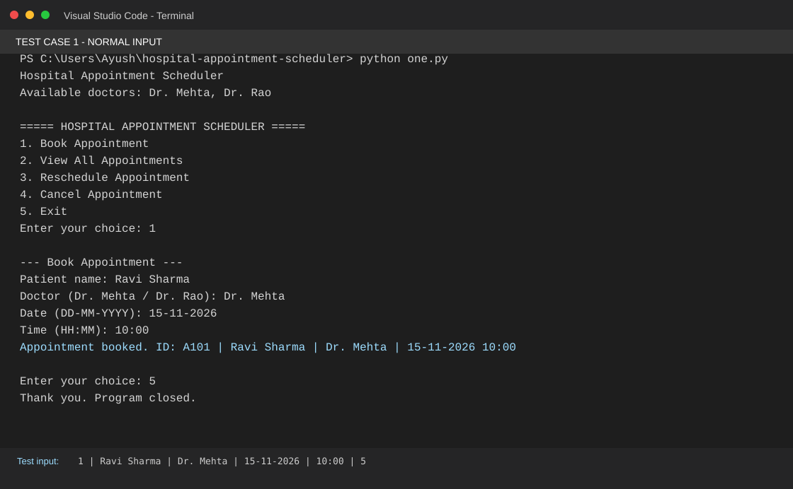
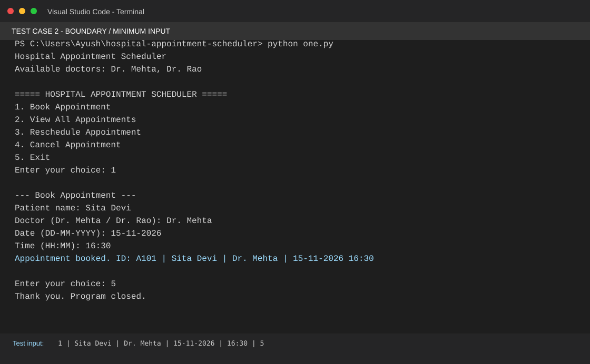
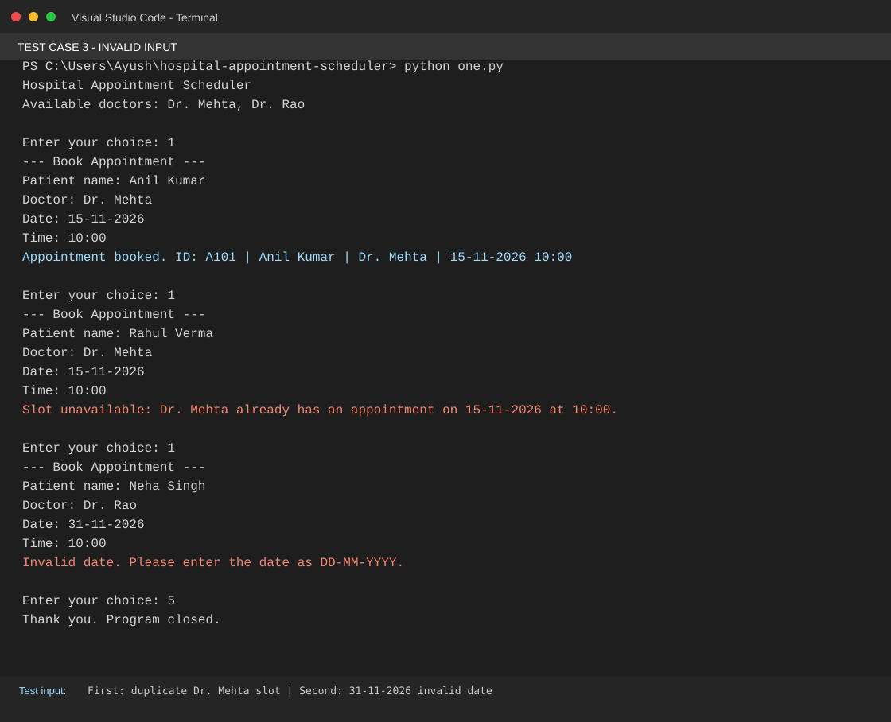
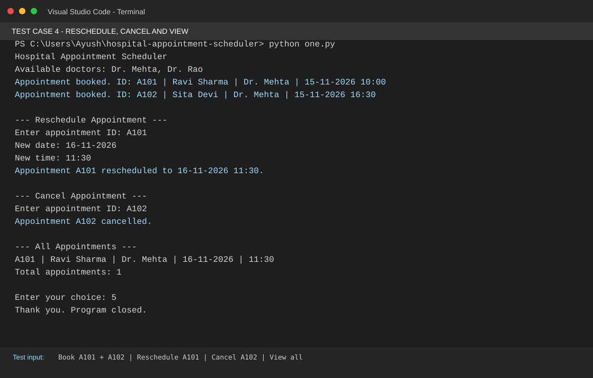

# Project Summary - Hospital Appointment Scheduler

**Submitted by:** Ayush Raj  
**Course:** B.Tech CSE - First Semester  
**Subject:** Programming Fundamentals and Logic Building Using Python  
**Problem Statement No.:** 74

## 1. What I implemented

I made a menu-based Python program for a clinic receptionist. The program has five options: Book Appointment, View All Appointments, Reschedule Appointment, Cancel Appointment and Exit.

I used a dictionary named `appt_list` to keep the appointment records. The appointment ID is used as the dictionary key. Each value stores the patient's name, doctor's name, date and time. The first appointment ID is `A101`, and the ID increases after every successful booking.

I used functions for the main tasks so that the code is easier to read and manage. I used the `datetime` module to check whether the entered date and time are valid. The program accepts appointment slots from 09:00 to 16:30 at 30-minute intervals. It also checks that the same doctor is not booked for two patients at the same date and time.

For rescheduling, the program checks the new date and time before changing the old appointment. While checking for a time conflict, it ignores the appointment being rescheduled. This avoids treating an appointment as a conflict with itself.

## 2. Python concepts used

| Concept | How I used it |
|---|---|
| Dictionary | To store appointment records using appointment IDs |
| Functions | To separate booking, viewing, rescheduling and cancellation work |
| `while` loop | To keep showing the menu until Exit is selected |
| `if-elif-else` | To perform the selected menu operation and check conditions |
| `for` loop | To check existing appointments and display them |
| `datetime` module | To validate dates, times and appointment slots |
| CRUD operations | To create, read, update and delete appointment records |

## 3. Difficulties I faced and how I handled them

### Checking an actual date
At first, checking only the date format was not enough because a date such as `31-11-2026` has the correct-looking format but does not exist. I used `datetime.strptime()` so that invalid calendar dates are also rejected.

### Checking 30-minute slots
I had to check both the allowed time range and the minutes. I added conditions so that a time such as `10:15` is not accepted, while `10:00` and `10:30` are accepted. The last slot, `16:30`, is also allowed.

### Avoiding double booking
Before saving an appointment, I compare its doctor, date and time with the appointments already stored in the dictionary. If the same doctor already has an appointment at that date and time, the new booking is rejected.

### Rescheduling an appointment
During rescheduling, the current appointment is already present in the dictionary. I added an `ignore_id` option in the conflict-checking function so that the program does not compare the appointment with itself. It still checks for conflicts with all other appointments.

## 4. Four separate test cases

Each test case below was run as a separate execution of `python one.py` in a fresh program session. The appointment dictionary therefore starts empty for each test. The screenshots are separate VS Code-style terminal captures.

### Test Case 1 - Normal Input

**Input:** Menu option 1; Ravi Sharma; Dr. Mehta; 15-11-2026; 10:00.

**Expected result:** Appointment is booked successfully. Since this is a fresh run, the generated ID is A101.

### Test Case 2 - Boundary / Minimum Input

**Input:** Menu option 1; Sita Devi; Dr. Mehta; 15-11-2026; 16:30.

**Expected result:** The appointment is booked successfully because 16:30 is the last allowed slot. Since this is a fresh run, the generated ID is A101.

### Test Case 3 - Invalid Input

**Input and actions:** First book Anil Kumar with Dr. Mehta on 15-11-2026 at 10:00. Then try the same doctor and slot again. Finally, try booking with the invalid date 31-11-2026.

**Expected result:** The first booking succeeds. The duplicate doctor slot is rejected, and the invalid date is also rejected.

### Test Case 4 - Reschedule, Cancel and View

**Input and actions:** Book Ravi Sharma and Sita Devi, reschedule A101 to 16-11-2026 at 11:30, cancel A102, and select View All.

**Expected result:** A101 is rescheduled, A102 is cancelled, and the final list contains only A101. Total appointments: 1.

## 5. How to run the program

1. Keep `one.py` in the project folder.
2. Open the folder in Visual Studio Code.
3. Open the integrated terminal using Terminal > New Terminal.
4. Run `python one.py`.
5. Enter `1`, `2`, `3`, `4` or `5` to use the menu.

## 6. Conclusion

This project helped me practise dictionaries, functions, loops, conditions and date-time validation in Python. I also understood how CRUD operations work in a small real-life type of program. The program completes the booking, viewing, rescheduling and cancellation tasks mentioned in the problem statement.

**Limitation:** The records are stored in a dictionary in program memory. They are not saved permanently, so they are cleared after the program is closed. Permanent storage was not included in the minimum requirements.
